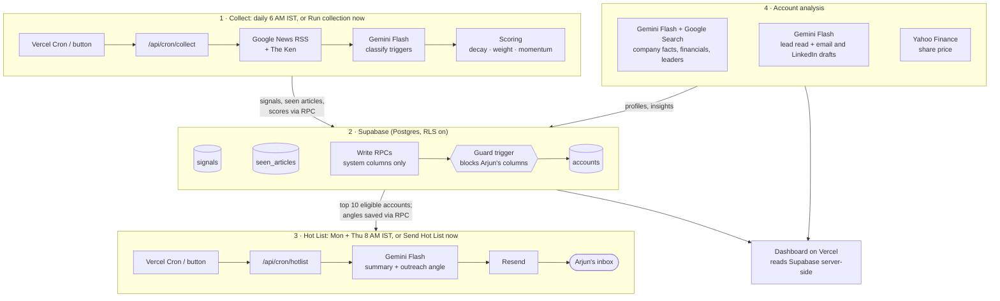

# Signal Desk: B2B account signal monitor

> Demo project. Companies and news are real; Arjun, his product and all deal notes are fictional. Built for a Mesa School of Business exam project.

**Live dashboard:** https://soft-launch-psi.vercel.app
**How it works (Components Map):** https://soft-launch-psi.vercel.app/how-it-works

Arjun sells workforce management software ("ShiftSense") to mid-market and enterprise companies in India and tracks 40 accounts at different deal stages. His problem is timing: which accounts have a fresh trigger event that makes *this* the right week to reach out?

Signal Desk:

1. Reads live news for all 40 accounts every morning (Google News RSS, plus The Ken's headlines).
2. Uses **Gemini Flash** to decide which articles are real trigger events, what type, and how strong.
3. Scores every account so fresh signals rise and quiet accounts fall on their own.
4. Writes results to **Supabase**, touching only system columns. Arjun's columns are protected in the database itself.
5. Every **Monday and Thursday morning (IST)** emails Arjun a Hot List: the top 10 accounts with signals from the last 3 days, each with a one-line summary and a Gemini-drafted outreach angle.
6. Shows everything on a dashboard deployed on **Vercel**: lead-temperature meters, charts, and a full analysis page per company (founding year, the trigger, financials with the annual report, live share price, recent news, the AI's read on how to approach the lead, senior leadership, and ready-to-send email and LinkedIn drafts).

## Requirements checklist

| Requirement | Where |
|---|---|
| All AI uses Gemini Flash (no other AI provider) | `lib/gemini.ts`, prompts in `lib/prompts.ts` |
| Deployed on Vercel with a public URL | https://soft-launch-psi.vercel.app |
| Database is Supabase | `supabase/migrations/` |
| Live external data | Google News RSS + The Ken headlines, `lib/news.ts` |
| Never overwrite Arjun's columns, enforced in the database | No direct UPDATE privilege, write-only RPCs, guard trigger; proven by `npm run test:protection` |
| Hot List email Mon + Thu mornings IST, top 10 from last 3 days, summary + outreach angle | `vercel.json`, `lib/hotlist.ts`, `lib/email.ts` |
| Quiet accounts fall automatically | Time decay in `lib/scoring.ts`, every account rescored daily (`lib/rescore.ts`) |
| Public repo + Components Map | This README and `/how-it-works` |

## Components Map



(Source of truth: `lib/componentsMap.ts`, which also renders on `/how-it-works`.)

## Architecture

**Stack:** Next.js 16 (App Router, TypeScript) on Vercel · Supabase Postgres via `@supabase/supabase-js` (service role key, server-side only) · Gemini Flash via `@google/genai` in JSON mode with a response schema, validated with zod · Google News RSS parsed with `fast-xml-parser` · Resend for email · Vercel Cron · plain CSS with variables.

### Collect (daily)

For each account, least recently checked first (`lib/collect.ts`):

1. **Fetch news:** three Google News RSS queries per company, India edition, last 7 days: the company's search terms combined with two groups of trigger keywords (hiring, appoints, CHRO, funding, IPO, expansion, attrition, layoffs, strike, digital…), plus `site:the-ken.com`. Results are de-duplicated by URL and headline.
2. **Skip seen articles:** anything this account has already sent to Gemini (`seen_articles`).
3. **Classify with Gemini (prompt A):** all new articles for one company in a single call (at most 40), plus its signals from the last 14 days so repeat coverage is recognised. Gemini checks each article is really about the company, groups articles about the same event, flags duplicates, and labels each real trigger with a type, strength 1–10, a factual summary and reasoning.
4. **Save:** one `signals` row per new event (earliest article is the source of record); every article is marked in `seen_articles`.
5. **Rescore every account** (not only those with news) and write back through `update_account_signals`.

Reliability: each run stops starting new accounts after ~250 s (the route's limit is 300 s) and the next run continues where it left off. Gemini calls are spaced 4 s apart and retried on 429/5xx with exponential backoff. One company failing never stops the run. Every run is logged in `pipeline_runs`.

### Hot List (Monday and Thursday)

`lib/hotlist.ts`:

1. Collects first for any account not checked in the last 6 hours.
2. **Eligible:** accounts with at least one signal published in the last `HOT_LIST_WINDOW_DAYS` (3).
3. Ranks eligible accounts by score; takes the top 10.
4. **Gemini prompt B** writes a one-line summary (≤ 20 words) and an outreach angle (≤ 45 words) from the last 30 days of signals, tailored to the deal stage (prospect: a reason to talk; pilot: a reason to expand; customer: an upsell). Arjun's deal stage and notes are passed as **read-only** context.
5. Clears old ranks and angles, sets new ones via RPC.
6. Builds a table-based, inline-styled email and sends it with Resend, or saves it without sending when `DRY_RUN=true`. Every build is stored in `hotlists` and shown at `/hotlist/preview`.

If fewer than 10 accounts are eligible, the email lists the eligible ones and then a clearly marked "Still warm, no fresh news" section with up to 3 next-highest accounts.

### Schedule (`vercel.json`, UTC → IST)

| Cron | IST | Job |
|---|---|---|
| `30 0 * * *` | ~6:00 AM daily | Collect |
| `30 1 * * *` | ~7:00 AM daily | Collect (finishes accounts the first run could not reach within its time limit; one run checks about 25 accounts on Vercel) |
| `30 2 * * 1,4` | ~8:00 AM Mon + Thu | Hot List |

On Vercel's free plan a cron can start anywhere within its hour.

### Dashboard

| Page | Shows |
|---|---|
| `/` | Hot/warm/cool/cold counts, gauges for the hottest leads, charts (triggers per day, triggers by type, pipeline temperature by deal stage), and the Hot List as a compact ranked table |
| `/accounts` | All 40 accounts in a sortable, filterable table with a temperature meter; quiet accounts greyed at the bottom |
| `/accounts/[id]` | Full analysis (see below), with "Arjun's notes" in its own panel that the system never edits |
| `/how-it-works` | Components Map, trigger taxonomy, scoring, protection, account analysis, limitations (linked in the footer) |
| `/hotlist/preview` | The latest email as sent (or as built in dry-run mode) (linked in the footer) |

### Account analysis

Each account page (`app/accounts/[id]/page.tsx`) is a full brief on the company:

- **Lead temperature** (`lib/heat.ts`): the score mapped to 0–100 with diminishing returns (`100 × (1 − e^(−score/12))`), banded Hot ≥ 65, Warm ≥ 35, Cool > 0, Cold. Shown as gauges and meters in one hue, light to dark.
- **Company facts** (`lib/profile.ts`): Gemini Flash with **Google Search grounding** researches founding year, headquarters, listing and NSE symbol (or the listed parent's), latest financials, the annual report, and senior leadership. A second Gemini call extracts structured facts *only* from those notes. Grounding sources are resolved to real URLs and stored with the profile; the newest annual-report PDF among them is linked. Refreshed every 14 days, using spare time after the morning collect.
- **Share price** (`lib/live.ts`): six months of NSE closes from Yahoo Finance, cached for an hour.
- **Recent news**: the last 14 days from the same Google News search, cached for an hour.
- **What the AI says** (`lib/insights.ts`): Gemini Flash writes a verdict, why now, three approach steps, talking points, risks, the best first contact, an email (under 130 words) and a LinkedIn note (under 280 characters). Arjun's stage and notes are read-only context. Regenerated when a newer signal arrives or after a week.
- **Drafts are never sent automatically.** They are editable on the page and open in Gmail or the mail app, or copy for LinkedIn (leaders are linked by LinkedIn search, never scraped).

Run `npm run enrich` to research every company and write insights (`-- --force Zepto` to redo one).

### Access model

The dashboard and both run buttons are open to anyone with the link, so a reviewer can try every feature without a password. Everything else is closed:

- API keys (Supabase service role, Gemini, Resend, cron secret) are server-side only; none appear in the browser bundle.
- The database has RLS on every table and no access for the anon role; the dashboard reads through server code.
- Cron routes require `CRON_SECRET`.
- The public buttons are rate-limited: Send Hot List at most once per 10 minutes and 6 times per day; Run collection cannot overlap another run (and already-seen articles never reach Gemini again).
- The site is marked `noindex`.

## Database

Tables (`supabase/migrations/001_init.sql` to `005_profiles_and_insights.sql`):

- **`accounts`**: one row per account, with columns split by owner. *Setup:* `company_name`, `search_terms`, `sector`. *Arjun's:* `deal_stage`, `arjun_notes`, `last_contact_date`, `relationship_read`. *System:* `signal_score`, `latest_signal_*`, `outreach_angle`, `hot_rank`, `last_checked_at`.
- **`signals`**: one row per real trigger event, unique per account and source URL.
- **`seen_articles`**: every article already sent to Gemini, per account (one article can matter to two accounts, e.g. "Blinkit beats Zepto").
- **`pipeline_runs`**: run log for the dashboard and debugging.
- **`hotlists`**: every Hot List build with its email HTML and entries.
- **`company_profiles`** and **`account_insights`**: researched company facts with sources, and Gemini's read and drafts (`005_profiles_and_insights.sql`).

### How Arjun's columns are protected

1. **No direct writes.** The pipeline's key (`service_role`) has no INSERT, UPDATE or DELETE privilege on `accounts`.
2. **One write path.** The pipeline can only call `update_account_signals`, `clear_hot_list` and `set_hot_list_entry`, which name system columns only and mark the session as `app.writer = 'pipeline'`.
3. **Database guard.** A `BEFORE UPDATE` trigger raises an error if a pipeline write would change any of Arjun's or the setup columns. It also works the other way: Arjun's own write path (`update_arjun_fields`) cannot touch system columns.

`npm run test:protection` writes a unique marker into an account's `arjun_notes` and `last_contact_date`, runs the **full** pipeline for that account (news → Gemini → signals → rescore → write-back), checks the marker survived while system columns were updated, then attempts a direct table update and a pipeline-style write to `arjun_notes`. Both are refused, and the original values are restored. Output ends with `ALL CHECKS PASSED: 8/8`.

## Design decisions

### Trigger taxonomy

| Type | Meaning | Weight |
|---|---|---|
| `new_leader` | New CHRO, Head of HR, VP Ops or COO; HR/ops reshuffles | 1.3 |
| `funding` | Funding round, IPO, PE investment, large growth debt | 1.2 |
| `headcount_expansion` | Hiring drives; new plants, warehouses, stores, hospitals; new cities | 1.2 |
| `workforce_digitalisation` | HR tech or ERP rollouts; automating attendance or rostering | 1.1 |
| `operational_challenge` | Attrition, shortages, strikes, overtime disputes, compliance pressure, layoffs, mergers | 1.0 |
| `other_relevant` | Relevant but fits none of the above; cannot top the list alone | 0.5 |

Not triggers: share price moves, analyst ratings, results with no workforce angle, unrelated product launches, CSR, awards, sector commentary, passing mentions. After the first live run, prompt A was tightened: routine same-kind announcements (e.g. seven hotel signings) are one event; future signings and non-India activity score lower; generic IT/cloud upgrades are not workforce digitalisation; regulatory or product problems not about staff are not operational challenges.

### Scoring (`lib/scoring.ts`)

```
signal value  = strength × type weight × 0.5 ^ (age in days ÷ 7)
account score = sum of signal values from the last 30 days
                × 1.2 if 2+ different signal types in the last 14 days
```

- **Half-life of 7 days:** a signal from last week is worth half of today's, so fresh news rises and accounts with no new news fall by themselves, reaching 0 after 30 days. Every account is rescored daily so the fade is applied even without news.
- **Signals add up:** a pattern (funding, then a new HR head, then hiring) outranks a single fresh headline, which is how a real buying window looks.
- **Momentum bonus:** two or more *different* types within 14 days earn ×1.2.
- **Hot List eligibility still needs a signal in the last 3 days,** as the brief requires; the score only decides the order.

### Accounts

40 real Indian companies chosen by Rajshree: a mix of enterprises (where a trigger opens a vendor-replacement chance) and fast-scaling mid-market companies (where Arjun could be the first proper system), across quick commerce and food, logistics, retail, hospitals, hotels and restaurants, BPO/staffing/facility services, and manufacturing. Ambiguous names use specific search terms (e.g. `"DMart" OR "Avenue Supermarts"`, `"Porter" logistics`, `"Teleperformance" India`). After a news-volume check, Startek India and Pristyn Care were swapped for Fusion CX and Medanta. Arjun's notes are fictional and refer to roles, not real people.

## Setup

1. **Clone and install**
   ```bash
   git clone https://github.com/rajshreemohta-sys/soft-launch.git
   cd soft-launch
   npm install
   ```
2. **Supabase:** create a project, then in the SQL editor run `supabase/migrations/001_init.sql` to `005_profiles_and_insights.sql` in order, then `seed/seed.sql`. (`seed/seed.sql` is generated from `seed/accounts.json` by `node seed/build-seed-sql.mjs`.)
3. **Gemini:** create an API key in Google AI Studio.
4. **Resend:** create an account and an API key. With the test sender, the email only reaches the Resend account owner.
5. **Environment:** copy `.env.example` to `.env.local` and fill it in; add the same variables in Vercel → Settings → Environment Variables (secrets as *Secret*).
6. **Run locally:** `npm run dev`, then open http://localhost:3000.
7. **Deploy:** import the repo into Vercel (or `vercel --prod`). The crons in `vercel.json` are picked up automatically.

### Environment variables

| Name | Purpose |
|---|---|
| `NEXT_PUBLIC_SUPABASE_URL` | Supabase project URL |
| `SUPABASE_SERVICE_ROLE_KEY` | Server-side database key (never sent to the browser) |
| `GEMINI_API_KEY` | Google AI Studio key |
| `GEMINI_MODEL` | `gemini-3.8-flash` (see limitations) |
| `RESEND_API_KEY` | Resend key |
| `HOTLIST_TO_EMAIL` | Recipient (the Resend account email on the free plan) |
| `HOTLIST_FROM_EMAIL` | Optional sender on a verified domain |
| `CRON_SECRET` | Shared secret Vercel Cron sends as a Bearer token |
| `HOT_LIST_WINDOW_DAYS` | Eligibility window, default 3 |
| `DRY_RUN` | `true` builds and saves the email without sending |
| `APP_URL` | Optional base URL for email links |

## Commands and tests

```bash
npm test                    # scoring unit tests: decay, weights, momentum, quiet accounts, pattern beats single signal
npm run test:protection     # proves the pipeline cannot overwrite Arjun's columns (8 checks)
npm run e2e:dry             # end-to-end dry run: collect all accounts, then build the Hot List without sending
npm run collect             # collect all accounts (or: npm run collect -- Zepto DMart)
npm run hotlist             # build and send the Hot List (add -- --dry-run to only build)
npm run rescore             # rescore every account without fetching news
npm run news:coverage       # count recent articles per company, to spot accounts with thin news
npm run enrich              # research company profiles and write AI insights (missing or stale only)
```

## Limitations

- **No LinkedIn.** LinkedIn posts can't be reliably or legally scraped, so the system relies on news and press coverage, which reports the same major events (new leaders, funding, expansion).
- **Google News RSS returns a limited, slightly varying set of results per query,** so an event can be missed on one run and caught on the next.
- **The Ken is read through its public headlines only** (via Google News); paywalled articles are never fetched. Its own RSS feed has only ten items and no summaries.
- **Gemini can misjudge an article or a search result,** so every signal links to its source and shows Gemini's reasoning, and every company profile lists its research sources. Check a leader's name and title before contacting them.
- **Private companies publish no balance sheet;** their figures come from regulatory filings reported in the news, and some are not disclosed.
- **Share prices come from Yahoo Finance's public chart endpoint,** which is unofficial and can change; the page shows "price unavailable" if it fails.
- **Gemini version:** Google closed `gemini-2.5-flash` to new API keys ("no longer available to new users"), so the app uses `gemini-3.8-flash`. The model is one environment variable.
- **Vercel free plan:** crons run once a day each and can start anywhere within their hour; a function run is capped at 300 s, which covers about 25 accounts, hence the second morning collect run.
- **Resend free plan:** with the test sender, the Hot List can only be delivered to the Resend account owner's inbox, so it goes to the student's address standing in for Arjun's. A verified domain removes this limit.
- **Strict 3-day window:** news published on Thursday after the morning email but before Friday morning is more than 3 days old by Monday's email, so it counts in the score but cannot make Monday's Hot List. `HOT_LIST_WINDOW_DAYS=4` would close the gap but stretches the brief.

## Project structure

```
app/                 pages (Hot List, accounts, account detail, how it works, email preview) and API routes
  api/cron/          collect + hotlist, called by Vercel Cron (CRON_SECRET)
  api/run/           collect + hotlist, called by the dashboard buttons (rate-limited)
components/          header, run buttons, cards, tags, arcs, Mermaid diagram, email frame
lib/                 news, Gemini, prompts, collect, scoring, rescore, Hot List, email, data access
supabase/migrations/ schema, write-path RPCs, guard trigger, RLS
seed/                40 accounts (JSON) and generated SQL
scripts/             command-line runners for collect, Hot List, tests, coverage
tests/               scoring unit tests
```
